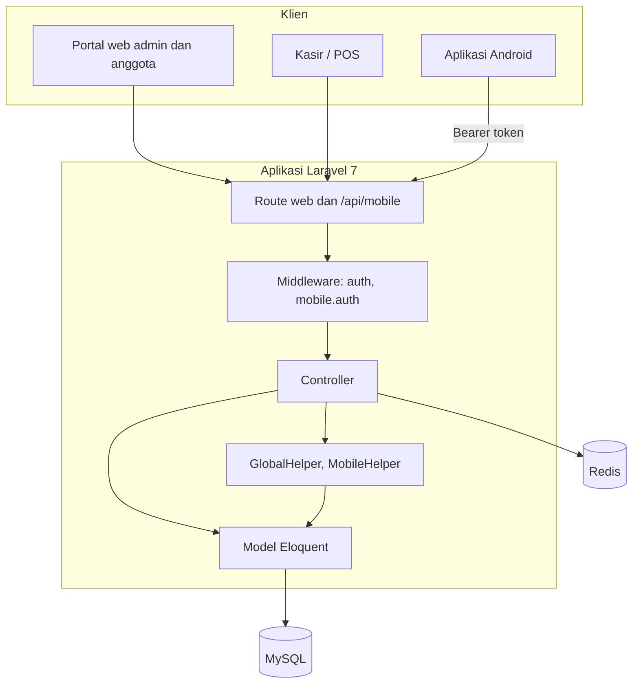

# eSIMKO

[English](README.md) · **Bahasa Indonesia**

eSIMKO (Elektronik Sistem Informasi dan Manajemen Koperasi) adalah sistem manajemen untuk koperasi karyawan. Aplikasi web mencakup keanggotaan, simpanan, pinjaman, kasir dan stok toko koperasi, akuntansi, serta potongan payroll. Aplikasi Android native memungkinkan anggota mengecek saldo dan angsuran, mengajukan pinjaman, berbelanja, dan membaca berita koperasi tanpa perlu antre di kasir. Antarmukanya berbahasa Indonesia.


## Daftar isi

- [Modul](#modul)
- [Aplikasi mobile](#aplikasi-mobile)
- [Arsitektur](#arsitektur)
- [Teknologi](#teknologi)
- [Memulai](#memulai)
- [Docker dan deployment](#docker-dan-deployment)
- [API mobile](#api-mobile)
- [Backup database](#backup-database)
- [Pengujian](#pengujian)
- [Struktur proyek](#struktur-proyek)
- [Dokumentasi](#dokumentasi)
- [Lisensi](#lisensi)

## Modul

### Keanggotaan (`anggota`)

Pendaftaran, verifikasi, profil dan riwayat anggota, serta status anggota: menunggu verifikasi, aktif payroll, aktif non-payroll, dan non-aktif. Pendaftaran baru dari web maupun aplikasi otomatis membuat hak akses anggota, sehingga anggota yang sudah disetujui bisa langsung login.

### Simpanan (`simpanan`)

| Jenis | Nama |
|---|---|
| 1 | Simpanan Pokok (sekali bayar) |
| 2 | Simpanan Wajib (bulanan) |
| 3 | Simpanan Sukarela |
| 4 | Simpanan Hari Raya |
| 5 | Bunga Simpanan |
| 6, 7 | Penarikan sukarela dan penarikan hari raya |
| 8 | Penutupan Simpanan |

Setoran, penarikan, potongan payroll, posting bunga, dan buku simpanan yang bisa dicetak.

### Pinjaman (`pinjaman`)

| Jenis | Nama | Tenor maksimal |
|---|---|---|
| 9 | Pinjaman Jangka Panjang | 50 bulan |
| 10 | Pinjaman Jangka Pendek | 18 bulan |
| 11 | Pinjaman Barang | 18 bulan |

Aturan bisnis: total angsuran tidak boleh melebihi 50% gaji anggota, pinjaman sejenis yang masih berjalan harus dilunasi lebih dulu, dan bunga 1% per bulan. Setiap pengajuan baru wajib melampirkan slip gaji tiga bulan terakhir; pinjaman jangka panjang juga wajib melampirkan Surat Hutang bermaterai. Angsuran bisa dipotong lewat payroll.

### Toko dan kasir (`pos`)

- Layar kasir untuk penjualan di toko, konsinyasi, dan pesanan online, dengan pembayaran tunai, kartu debit, atau kredit (angsuran).
- Daftar penjualan, retur, dan angsuran belanja kredit.
- Keranjang belanja dan checkout anggota dari aplikasi mobile.

### Manajemen stok (`manajemen_stok`)

Produk dan kategori, supplier, pembelian dan retur pembelian, stok opname, serta cetak barcode dan label harga. Stok dihitung dari stok awal ditambah pembelian, dikurangi retur pembelian, dikurangi penjualan, ditambah retur penjualan, ditambah penyesuaian.

### Keuangan (`keuangan`)

Bagan akun, jurnal umum, buku besar, buku kas, laba rugi, dan neraca.

### Laporan dan administrasi

Laporan penjualan, pembelian, retur, mutasi stok, dan penyesuaian dengan ekspor Excel (Laravel Excel), cetak payroll, halaman monitoring, peran pengguna (administrator, anggota, operator simpan pinjam, executive user), pengelolaan rilis APK Android, dan pembaruan sistem dari dalam aplikasi.

## Aplikasi mobile

`EsimkoMobile/` adalah aplikasi Android native (package `com.esimko.mobile`, versi 1.0.14) untuk anggota.

- Beranda yang menyapa anggota dengan nama dan nomor anggota, beserta saldo simpanan dan pinjaman.
- Riwayat simpanan dan angsuran dengan pencarian serta urutan terbaru atau terlama.
- Pengajuan pinjaman dengan unggah dokumen (tiga slip gaji, ditambah surat bermaterai untuk pinjaman jangka panjang) dan estimasi angsuran yang memakai pengaturan bunga dari server.
- Toko koperasi dengan keranjang, checkout, pembatalan, dan retur.
- Berita koperasi, riwayat aktivitas, profil, dan ganti password.
- Banner di dalam aplikasi untuk pembaruan yang tidak wajib, serta halaman Tentang.
- Token sesi disimpan di penyimpanan terenkripsi; bila keystore berubah, aplikasi mereset sesi dengan aman dan meminta anggota login ulang, bukan force close.

Prasyarat: Android 9 (API 28) atau lebih baru. Desainnya menargetkan WCAG AA: kontras teks minimal 4.5:1, target sentuh minimal 48 dp, dukungan tema gelap, dan mengikuti pengaturan Reduce Motion sistem.

## Arsitektur



## Teknologi

| Lapisan | Teknologi |
|---|---|
| Web | Laravel 7, PHP 7.4, Blade, jQuery, Bootstrap 4, Laravel Mix |
| Data | MySQL 8, Redis |
| Laporan | Laravel Excel (maatwebsite/excel) |
| Mobile | Kotlin, Jetpack Compose (Material 3), Hilt, KSP, Gradle |
| Infrastruktur | Docker (nginx, php7.4-fpm), Nginx Proxy Manager (opsional) |

## Memulai

Prasyarat: PHP 7.4, Composer, Node.js, dan MySQL.

```bash
composer install
npm install
cp .env.docker .env      # sesuaikan DB_* dan APP_URL dengan komputer Anda
php artisan key:generate
npm run dev              # kompilasi aset (npm run watch selama development)
php artisan serve
```

Impor backup database dengan `db-import.ps1` (lihat [Backup database](#backup-database)) atau dari folder `Esimko backup database/`.

### Aplikasi Android

```bash
cd EsimkoMobile
./gradlew assembleDebug  # app/build/outputs/apk/debug/app-debug.apk
```

## Docker dan deployment

```bash
docker compose up -d --build     # http://localhost:8080
```

| File compose | Kegunaan |
|---|---|
| `docker-compose.yml` | Satu container aplikasi (nginx, MySQL, PHP-FPM, SSH) ditambah Redis. Port 8080, 8443, 2222 |
| `docker-compose.dev.yml` | Setup development |
| `docker-compose.prod.yml` | Produksi: container MySQL 8 terpisah, Redis, dan aplikasi Laravel |
| `docker-compose.npm.yml`, `docker-compose.npm-standalone.yml` | Produksi di belakang Nginx Proxy Manager |

Skrip deployment:

| Skrip | Kegunaan |
|---|---|
| `deploy-prod.ps1` | Deploy produksi tanpa NPM. Opsi: `-SkipDbExport`, `-SkipDbImport`, `-Fresh` |
| `deploy.ps1`, `deploy.bat` | Helper deploy untuk Windows |
| `deploy-windows-server.ps1` | Instalasi di Windows Server |
| `deploy-ubuntu.sh` | Instalasi di Ubuntu 22.04 (PHP 7.4 dari PPA) |

Isi `DB_ROOT_PASSWORD` dan `DB_PASSWORD` sebelum memakai file compose produksi; nilai default di file hanyalah placeholder. [docs/NPM Documents.md](docs/NPM%20Documents.md) menjelaskan pengaturan Nginx Proxy Manager.

## API mobile

Semua endpoint berada di bawah `/api/mobile`. `auth/login` dan `auth/register` bersifat publik; selain itu wajib menyertakan `Authorization: Bearer <token>` dan melewati middleware `mobile.auth`, yang mencari anggota dari token lalu menyisipkan nomor anggota di sisi server, sehingga klien tidak bisa bertindak atas nama anggota lain.

| Area | Endpoint |
|---|---|
| Auth | `auth/login`, `auth/register`, `auth/logout` |
| Anggota | `anggota/profil`, `anggota/ubah_password`, `upload_avatar`, `gaji_pokok` |
| Transaksi | `transaksi/{modul}`, `transaksi/{modul}/detail`, `transaksi/{jenis}/proses`, `transaksi/batalkan`, `transaksi/upload_dokumen`, `transaksi/upload_bukti_transaksi`, `transaksi/slip_gaji`, `riwayat_transaksi`, `angsuran` |
| Belanja | `produk`, `produk/detail`, `belanja/keranjang`, `belanja/keranjang/checkout`, `belanja/keranjang/proses`, `belanja/batalkan`, `belanja/retur`, `belanja/angsuran` |
| Referensi | `master/jenis_transaksi/{modul}`, `master/status_transaksi/{modul}`, `master/syarat_pinjaman`, `berita`, `berita/detail`, `version` |

Respons memakai satu bentuk JSON, `{success, message, data[, meta]}`, yang dibangun oleh `app/Support/ApiResponse.php`.

Dokumen identitas dan slip gaji tidak disajikan lewat route publik `/storage`; keduanya hanya bisa diakses melalui route yang mewajibkan login.

## Backup database

```powershell
.\db-export.ps1                  # ekspor database lokal ke backups/
.\db-export.ps1 -Production      # ekspor dari produksi
.\db-import.ps1 [-Production]    # impor backup
```

## Pengujian

```bash
vendor/bin/phpunit
vendor/bin/phpunit --filter=SomeTest
```

Proyek Android punya unit test untuk alur dokumen pinjaman; jalankan dengan `./gradlew test` di `EsimkoMobile/`.

## Struktur proyek

```
app/
  Http/Controllers/     controller web dan MobileController (API mobile)
  Http/Middleware/      termasuk MobileAuth
  Helpers/              GlobalHelper, MobileHelper
  Support/ApiResponse.php
  *.php                 model Eloquent (Anggota, Transaksi, Pinjaman, Simpanan, Produk, ...)
resources/views/        template Blade
routes/                 web.php, api.php
database/               migrasi dan seed
EsimkoMobile/           aplikasi Android (Kotlin, Compose)
docker/                 konfigurasi nginx, supervisord, daemon Docker
docs/                   dokumentasi aplikasi, review, laporan perbaikan
```

## Dokumentasi

- [docs/APPLICATION_DOCUMENTATION.md](docs/APPLICATION_DOCUMENTATION.md): modul, skema, route, dan alur transaksi
- [docs/PROJECT_REVIEW.md](docs/PROJECT_REVIEW.md): review proyek
- [PRODUCT.md](PRODUCT.md) dan [DESIGN.md](DESIGN.md): prinsip produk dan desain aplikasi mobile

## Lisensi

Repositori ini belum menyertakan file lisensi. Hubungi pengembang sebelum menggunakan ulang kode ini.

Dikembangkan oleh Yohanes Octavian Rizky ([@torpedoliar](https://github.com/torpedoliar)).
