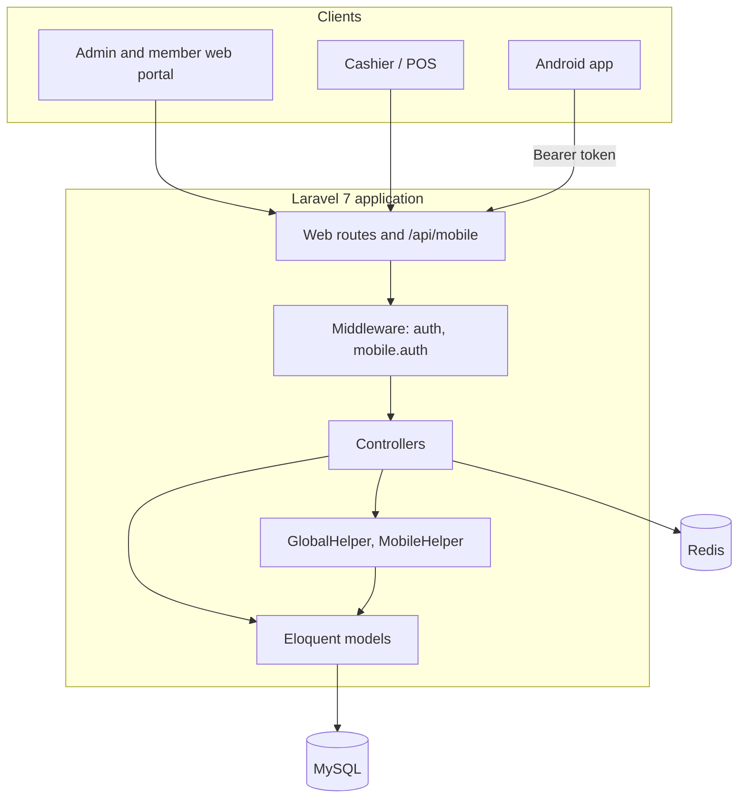

# eSIMKO

**English** · [Bahasa Indonesia](README.id.md)

eSIMKO (Elektronik Sistem Informasi dan Manajemen Koperasi) is a management system for an employee cooperative. The web application covers members, savings, loans, the cooperative shop's point of sale and inventory, accounting, and payroll deductions. A native Android app lets members check balances and installments, apply for loans, shop, and read cooperative news without queuing at the counter. The interface is in Indonesian.


## Contents

- [Modules](#modules)
- [Mobile app](#mobile-app)
- [Architecture](#architecture)
- [Tech stack](#tech-stack)
- [Getting started](#getting-started)
- [Docker and deployment](#docker-and-deployment)
- [Mobile API](#mobile-api)
- [Database backup](#database-backup)
- [Testing](#testing)
- [Project layout](#project-layout)
- [Documentation](#documentation)
- [License](#license)

## Modules

### Members (`anggota`)

Registration, verification, member profiles and history, and member status: pending verification, active on payroll, active off payroll, and inactive. New registrations from the web or the app create the member's access rights, so approved members can log in.

### Savings (`simpanan`)

| Type | Name |
|---|---|
| 1 | Simpanan Pokok (one-time principal) |
| 2 | Simpanan Wajib (mandatory monthly) |
| 3 | Simpanan Sukarela (voluntary) |
| 4 | Simpanan Hari Raya (holiday savings) |
| 5 | Bunga Simpanan (interest) |
| 6, 7 | Voluntary and holiday withdrawals |
| 8 | Penutupan Simpanan (account closure) |

Deposits, withdrawals, payroll deductions, interest posting, and a printable savings passbook.

### Loans (`pinjaman`)

| Type | Name | Maximum tenor |
|---|---|---|
| 9 | Pinjaman Jangka Panjang (long term) | 50 months |
| 10 | Pinjaman Jangka Pendek (short term) | 18 months |
| 11 | Pinjaman Barang (goods) | 18 months |

Business rules: total installments may not exceed 50% of the member's salary, an existing loan of the same type must be settled first, and interest is 1% per month. Every new application requires salary slips for the last three months; long-term loans also require a stamped debt acknowledgment letter (Surat Hutang bermaterai). Installments can be collected through payroll.

### Shop and point of sale (`pos`)

- Cashier screen for in-store sales, consignment, and online orders, with cash, debit card, or credit (installment) payment.
- Sales list, returns, and credit installments.
- Member shopping cart and checkout from the mobile app.

### Inventory (`manajemen_stok`)

Products and categories, suppliers, purchases and purchase returns, stock opname, and barcode and price label printing. Stock is calculated as opening stock plus purchases, minus purchase returns, minus sales, plus sales returns, plus adjustments.

### Accounting (`keuangan`)

Chart of accounts, general journal, general ledger, cash book, profit and loss, and balance sheet.

### Reports and administration

Sales, purchases, returns, stock movement, and adjustment reports with Excel export (Laravel Excel), payroll printouts, a monitoring page, user roles (administrator, member, savings and loan operator, executive user), Android APK release management, and in-app system updates.

## Mobile app

`EsimkoMobile/` is a native Android app (package `com.esimko.mobile`, version 1.0.14) for members.

- Dashboard that greets the member by name and member number, with savings and loan balances.
- Savings and installment history with search and newest or oldest sorting.
- Loan application with document uploads (three salary slips, plus the stamped letter for long-term loans) and loan estimates that use the server's interest settings.
- Cooperative shop with cart, checkout, cancellation, and returns.
- Cooperative news, activity history, profile, and password change.
- Non-blocking in-app banner for optional updates, and an About page.
- Session tokens kept in an encrypted store; if the keystore changes, the app resets the session safely and asks the member to log in again instead of crashing.

Requirements: Android 9 (API 28) or newer. The design targets WCAG AA: text contrast of at least 4.5:1, touch targets of at least 48 dp, dark theme support, and respect for the system Reduce Motion setting.

## Architecture



## Tech stack

| Layer | Technology |
|---|---|
| Web | Laravel 7, PHP 7.4, Blade, jQuery, Bootstrap 4, Laravel Mix |
| Data | MySQL 8, Redis |
| Reports | Laravel Excel (maatwebsite/excel) |
| Mobile | Kotlin, Jetpack Compose (Material 3), Hilt, KSP, Gradle |
| Infrastructure | Docker (nginx, php7.4-fpm), Nginx Proxy Manager (optional) |

## Getting started

Requirements: PHP 7.4, Composer, Node.js, and MySQL.

```bash
composer install
npm install
cp .env.docker .env      # adjust DB_* and APP_URL for your machine
php artisan key:generate
npm run dev              # compile assets (npm run watch while developing)
php artisan serve
```

Import a database backup with `db-import.ps1` (see [Database backup](#database-backup)) or from `Esimko backup database/`.

### Android app

```bash
cd EsimkoMobile
./gradlew assembleDebug  # app/build/outputs/apk/debug/app-debug.apk
```

## Docker and deployment

```bash
docker compose up -d --build     # http://localhost:8080
```

| Compose file | Purpose |
|---|---|
| `docker-compose.yml` | Single app container (nginx, MySQL, PHP-FPM, SSH) plus Redis. Ports 8080, 8443, 2222 |
| `docker-compose.dev.yml` | Development setup |
| `docker-compose.prod.yml` | Production: separate MySQL 8 container, Redis, and the Laravel app |
| `docker-compose.npm.yml`, `docker-compose.npm-standalone.yml` | Production behind Nginx Proxy Manager |

Deployment scripts:

| Script | Use |
|---|---|
| `deploy-prod.ps1` | Production deploy without NPM. Options: `-SkipDbExport`, `-SkipDbImport`, `-Fresh` |
| `deploy.ps1`, `deploy.bat` | Deploy helpers for Windows |
| `deploy-windows-server.ps1` | Windows Server installation |
| `deploy-ubuntu.sh` | Ubuntu 22.04 installation (PHP 7.4 from PPA) |

Set `DB_ROOT_PASSWORD` and `DB_PASSWORD` before using the production compose file; the defaults in the file are placeholders. [docs/NPM Documents.md](docs/NPM%20Documents.md) explains the Nginx Proxy Manager setup.

## Mobile API

All endpoints live under `/api/mobile`. `auth/login` and `auth/register` are public; everything else requires `Authorization: Bearer <token>` and goes through the `mobile.auth` middleware, which resolves the member from the token and injects the member number server-side, so the client cannot act for another member.

| Area | Endpoints |
|---|---|
| Auth | `auth/login`, `auth/register`, `auth/logout` |
| Member | `anggota/profil`, `anggota/ubah_password`, `upload_avatar`, `gaji_pokok` |
| Transactions | `transaksi/{modul}`, `transaksi/{modul}/detail`, `transaksi/{jenis}/proses`, `transaksi/batalkan`, `transaksi/upload_dokumen`, `transaksi/upload_bukti_transaksi`, `transaksi/slip_gaji`, `riwayat_transaksi`, `angsuran` |
| Shop | `produk`, `produk/detail`, `belanja/keranjang`, `belanja/keranjang/checkout`, `belanja/keranjang/proses`, `belanja/batalkan`, `belanja/retur`, `belanja/angsuran` |
| Reference | `master/jenis_transaksi/{modul}`, `master/status_transaksi/{modul}`, `master/syarat_pinjaman`, `berita`, `berita/detail`, `version` |

Responses use one JSON shape, `{success, message, data[, meta]}`, built by `app/Support/ApiResponse.php`.

Identity documents and salary slips are not served from the public `/storage` route; they are only available through routes that require login.

## Database backup

```powershell
.\db-export.ps1                  # export the local database to backups/
.\db-export.ps1 -Production      # export from production
.\db-import.ps1 [-Production]    # import a backup
```

## Testing

```bash
vendor/bin/phpunit
vendor/bin/phpunit --filter=SomeTest
```

The Android project has unit tests for the loan document flow; run them with `./gradlew test` in `EsimkoMobile/`.

## Project layout

```
app/
  Http/Controllers/     web controllers and MobileController (mobile API)
  Http/Middleware/      including MobileAuth
  Helpers/              GlobalHelper, MobileHelper
  Support/ApiResponse.php
  *.php                 Eloquent models (Anggota, Transaksi, Pinjaman, Simpanan, Produk, ...)
resources/views/        Blade templates
routes/                 web.php, api.php
database/               migrations and seeds
EsimkoMobile/           Android app (Kotlin, Compose)
docker/                 nginx, supervisord, Docker daemon config
docs/                   application documentation, reviews, fix reports
```

## Documentation

- [docs/APPLICATION_DOCUMENTATION.md](docs/APPLICATION_DOCUMENTATION.md): modules, schema, routes, and transaction flows
- [docs/PROJECT_REVIEW.md](docs/PROJECT_REVIEW.md): project review
- [PRODUCT.md](PRODUCT.md) and [DESIGN.md](DESIGN.md): mobile product and design principles

## License

This repository does not include a license file. Contact the author before reusing the code.

Developed by Yohanes Octavian Rizky ([@torpedoliar](https://github.com/torpedoliar)).
